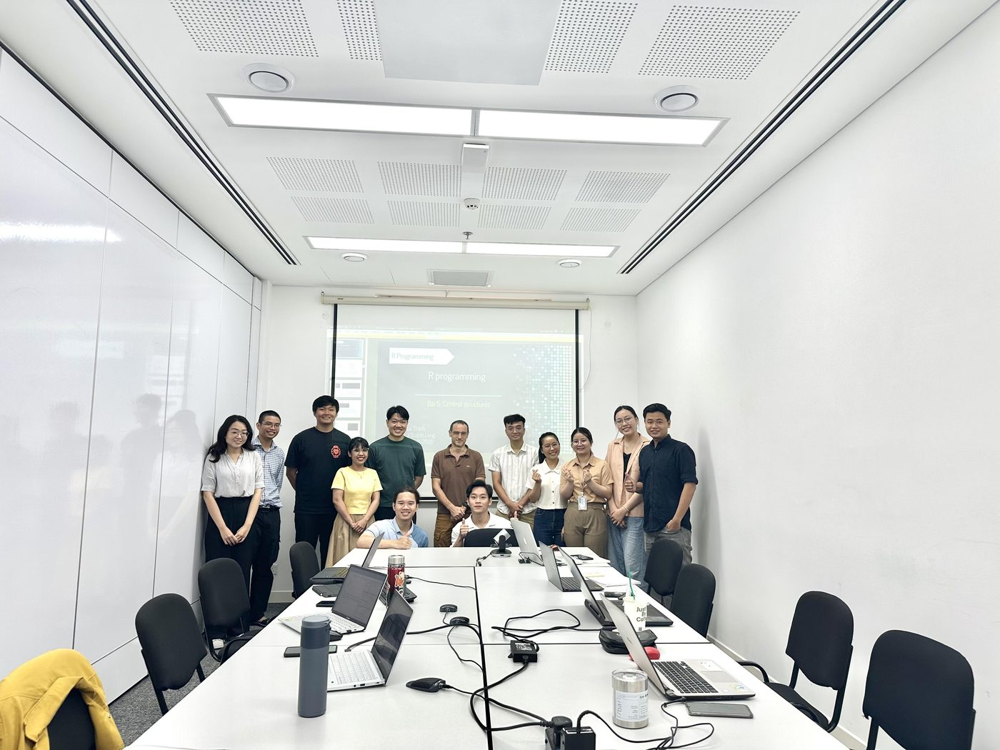
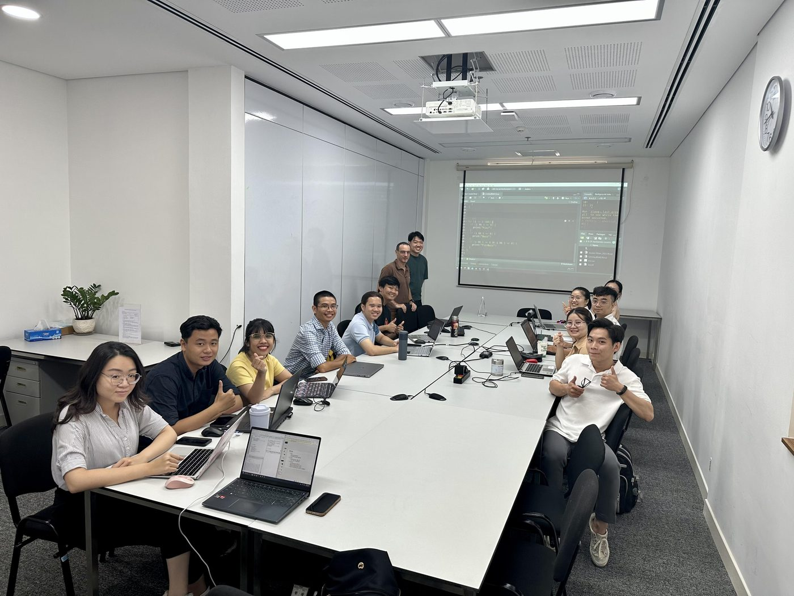

```{=html}
<div class="pg">
  <a class="back" href="../../index.html"><svg viewBox="0 0 24 24" aria-hidden="true"><path d="M19 12H5M11 6l-6 6 6 6"/></svg>Teaching</a>

  <header class="pg-head pg-head--pic">
    <div class="pg-head__main">
```

```{r}
#| output: asis
# The line above the title, the facts under the head and the "More in ..."
# cards come from the Sheet (R/teaching.R), the same rows as the CV. The text
# of this page (title, lead, links, photos) stays here.
source("../../../R/site-data.R")
source("../../../R/teaching.R")
tc <- teaching_courses()
id <- "r4babies"
cat(html_block(course_meta_html(tc, id)))
```

```{=html}
      <h1 class="pg-title rise d1">R for Babies</h1>
      <p class="pg-lead rise d2">A gentle, beginner-first path into R for data science. Taught for staff at the HCMC Centre for Disease Control, with live coding, real datasets, and plenty of small wins along the way.</p>
      <div class="pg-links"><a class="tl" href="https://drthinhong.com/r4babies/" target="_blank" rel="noopener">Course homepage<svg viewBox="0 0 24 24" aria-hidden="true"><path d="M7 17L17 7M8 7h9v9"/></svg></a></div>
    </div>
    <div class="pg-head__pic hue-ma rise d2"><span class="plate"><svg class="ic" viewBox="0 0 120 80" aria-hidden="true"><rect class="l3" x="16" y="48" width="16" height="18" rx="2"/><rect class="l2" x="40" y="38" width="16" height="28" rx="2"/><rect class="l1" x="64" y="28" width="16" height="38" rx="2"/><rect class="l" x="88" y="16" width="16" height="50" rx="2"/><path class="fs" stroke-width="2" d="M18 38L48 28L72 18L100 6"/><path class="fs" stroke-width="1.6" d="M10 66h100"/></svg></span></div>
  </header>

```

```{r}
#| output: asis
cat(html_block(course_facts_html(tc, id)))
```

```{=html}
  <section class="pg-part hue-ma pg-part--plain">
    <div class="pg-part__head">
      <div class="pg-part__line">
        <div class="pg-part__name"><h2 class="pg-sectitle">From the classroom</h2></div>
        <span class="pg-secsub">2 photos</span>
      </div>
    </div>
    <div class="frames">
      <figure class="frame">
        <span class="mat"></span>
        <figcaption>Live coding at HCMC CDC</figcaption>
      </figure>
      <figure class="frame">
        <span class="mat"></span>
        <figcaption>Hands-on session with participants</figcaption>
      </figure>
    </div>
  </section>
```

```{r}
#| output: asis
cat(html_block(course_more_html(tc, id)))
```

```{=html}
  <nav class="pg-next hue-te" aria-label="Back to">
    <a href="../../index.html">
      <span class="nx-main"><span class="nx-label">Back to</span><span class="nx-title">Teaching</span></span>
      <span class="nx-text">All courses and talks.</span>
      <svg viewBox="0 0 24 24" aria-hidden="true"><path d="M7 17L17 7M8 7h9v9"/></svg>
    </a>
  </nav>
</div>
```
